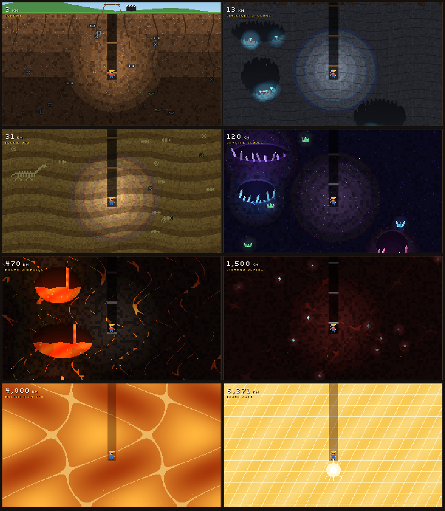

# Blockbust

A daily movie trivia game. Each day has 8 prompts ("Name a film directed by Steven Spielberg"), 20 seconds each, and as many guesses as you like. Any valid answer digs your miner deeper. Rarer answers dig further, and a perfect game reaches the center of the Earth.



## Quick start

Needs Node 22.13 or newer (`node -v`). It uses Node's built-in SQLite, so there's nothing native to compile.

```sh
npm install
npm run demo      # loads a small built-in catalog (~200 films) and builds the next 7 days
npm run dev       # game at http://localhost:5173, admin at http://localhost:5173/admin.html
```

## Real data from TMDB

1. Copy `.env.example` to `.env` and paste your TMDB key after `TMDB_API_KEY=`. Either the short API Key or the long Read Access Token works.
2. Run `npm run sync`. This pulls the 6,000 most-voted films with their cast, directors, studios and series, then joins IMDb ratings from IMDb's free dataset. Expect about 5 to 10 minutes. The first real sync removes the demo catalog.
   - `npm run sync -- --movies 10000` covers more films (rarer answers become possible).
   - Re-running only fetches films it doesn't have yet; add `--refresh` to re-fetch everything.
3. Run `npm run puzzles` to build any missing days through 6 days from now, or use the admin page.

## How a guess works

- The browser downloads the full catalog of titles and names for autocomplete. It never gets the answer lists.
- `POST /api/guess` turns the text (or the picked suggestion) into one film or person, checks the frozen answer set for that prompt, enforces the timer, and returns only `hit` with a tier, `miss`, `unknown`, or `ambiguous` with a few candidates.
- Text matching: normalization (case, accents, "the", "&", Roman numerals), an alias table, a unique-prefix match, then trigram + edit-distance for typos. It never looks at the answers, so it can't leak them.

## Rarity

Each answer gets a starting guess at how many players would say it, from TMDB vote counts (films) or popularity and billing (people), relative to the other answers to the same prompt. As real players answer, the share of first hits takes over:

```
share = (first hits on this answer + 50 * starting guess) / (players + 50)
```

| Tier | Share of players | Points |
| --- | --- | --- |
| Blockbuster | 25% or more | 10 |
| Crowd Pleaser | 10 to 25% | 25 |
| Hidden Gem | 3 to 10% | 50 |
| Cult Classic | 0.5 to 3% | 100 |
| Lost Reel | under 0.5% | 200 |

The scene fills the whole window. During play the question sits in a card at the bottom; at the end the scene dims and the score card scrolls over it.

Each point digs 4 km (6,371 km is the center). On the way down you pass through topsoil full of lost film reels, limestone caverns, a fossil bed, crystal geodes, magma chambers, the diamond depths, a molten iron sea and the inner core. In dev, run `blockbustPeek(1500)` in the browser console to jump to any depth.

### Jev

Add `TYPESAFE_API_KEY` to `.env` and the admin page's "Classify with Jev" button scores a prompt's top 150 answers on a 0 to 4 rarity scale. That score is blended with the vote-count guess. It only runs from the admin page, never during play.

## Streaks and miners

Stats live in the browser (`localStorage` key `blockbust:stats`): current and best daily streak,
daily digs, deepest and average dig. Only today's live puzzle counts, so `?date=` replays don't.
New miner skins unlock at best-streak milestones (3, 7, 14, 30, 60, 100 days) rather than score,
since a score can be farmed on a second device but a streak means showing up every day. Skins are
defined in `SKINS` in `web/src/scene.ts`.

## Admin page

`/admin.html` shows catalog counts and the last 60 days. For each day you can see every prompt's full answer list with its current tier, share, starting guess, Jev score and hits. You can swap a prompt (optionally for a different type), rebuild or clear a day's plays, and add aliases for fair guesses the matcher missed.

## Tuning knobs

| What | Where |
| --- | --- |
| Seconds per question | `QUESTION_SECONDS` in `.env` |
| Questions per day | `QUESTIONS_PER_DAY` in `server/src/puzzles.ts` |
| Tier names, thresholds, points, colors | `TIERS` in `shared/src/index.ts` |
| Km per point | `KM_PER_POINT` in `web/src/main.ts` |
| How fast real players outweigh the starting guess | `PRIOR_WEIGHT` in `server/src/rarity.ts` |
| Question types and their rules | `GENERATORS` in `server/src/puzzles.ts` |
| Nicknames ("sam jackson", "lotr") | `server/src/aliases.ts`, or the admin page |
| The dig scene, layers, sprites | `web/src/scene.ts` |

## Layout

```
shared/   types, tiers, text normalization (used by both sides)
server/   Hono API on :8787, SQLite in server/data/, TMDB sync, puzzle builder, Jev client
web/      Vite game (Canvas 2D pixel scene) and admin page on :5173
```

## Data credits

This product uses the TMDB API but is not endorsed or certified by TMDB. IMDb ratings come from IMDb's non-commercial datasets (https://developer.imdb.com/non-commercial-datasets/), which are fine for personal use. Check both licenses before running it publicly with ads.
